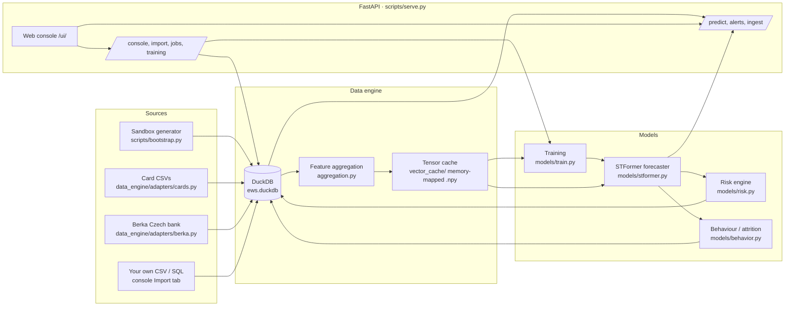
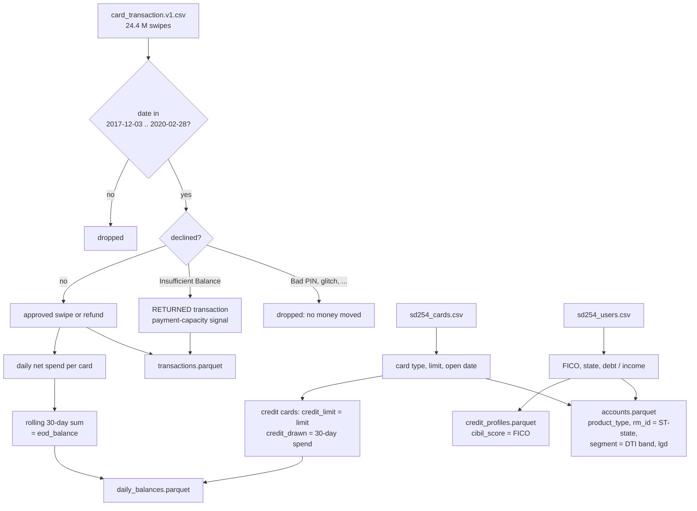
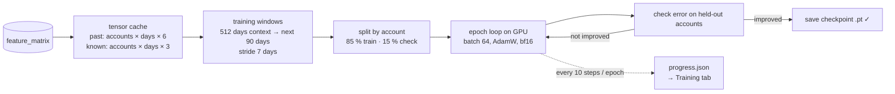
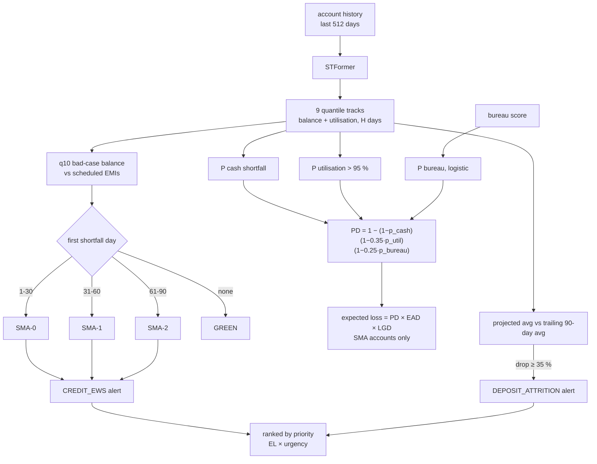
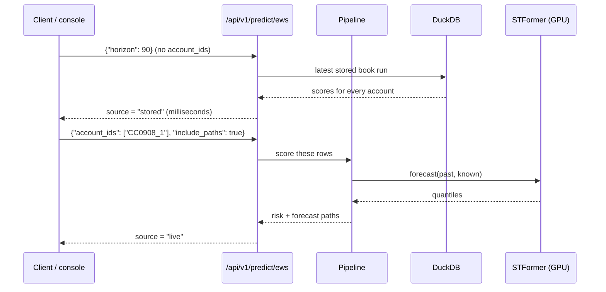
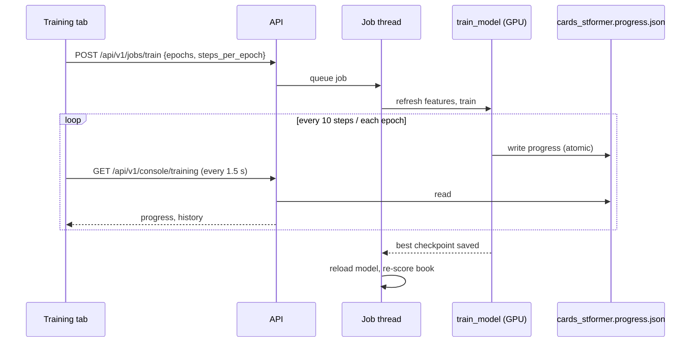
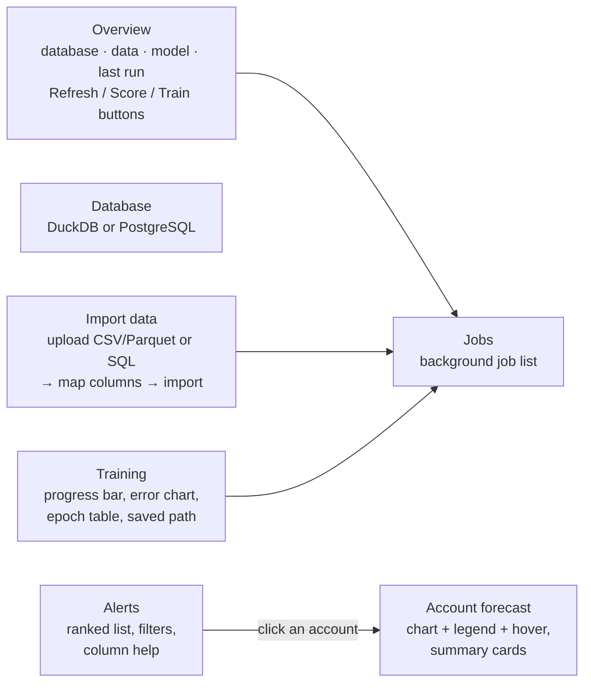

# EWS guide: system, datasets, API, web console and the card-data forecaster

This guide explains what the Early Warning System (EWS) does, which datasets it runs on in this
workspace, how data flows from raw files to alerts, every HTTP endpoint, the web console, and the
credit-card forecaster added on top of the original project. Diagrams are Mermaid (GitHub, VS Code
and most Markdown viewers render them).

Setup and the agent runbook are in [`RUNNING_LOCALLY.md`](RUNNING_LOCALLY.md) and
[`../AGENTS.md`](../AGENTS.md); this guide does not repeat them.

---

## 1. What the system is for

A bank usually learns about a problem account **after** a loan instalment (EMI) bounces. The EWS
is forward-looking: it forecasts every account's daily balance for the next 30/60/90 days as a
**range**, and compares that range with what the account has to pay.

| Question | How the EWS answers it |
|---|---|
| Will this customer miss a payment? | Forecast balance (bad-case track, q10) vs the next EMIs → **days to breach** and an **SMA tier** |
| How likely is default? | **PD** from three drivers: cash shortfall, credit-line over-use, bureau score |
| How much money is at risk? | **EAD** (exposure at default) and **expected loss** = PD × EAD × LGD |
| Is the customer leaving? | Projected balance/spend drop vs its own recent average → **attrition** alert |
| Who should a relationship manager call first? | Alerts ranked by **priority** = expected loss weighted by urgency |

SMA ("special mention account") tiers follow the Reserve Bank of India's early-stress buckets:

| Tier | Meaning |
|---|---|
| GREEN | no forecast shortfall within the horizon |
| SMA-0 | first forecast EMI shortfall 1–30 days out |
| SMA-1 | 31–60 days out |
| SMA-2 | 61–90 days out |

---

## 2. Architecture



| Layer | Main files | Role |
|---|---|---|
| Ingestion | `data_engine/ingestion.py`, `schema.py`, `importer.py` | Validate and upsert tables (accounts, daily_balances, transactions, credit_profiles, loan_schedules, holidays) |
| Aggregation | `data_engine/aggregation.py` | Build `feature_matrix`: balance, utilisation, bureau score, outflow volatility, missed-salary and payment-return flags per account-day |
| Tensor cache | `data_engine/vector_cache.py` | Snapshot the features into memory-mapped arrays `[accounts × days × channels]` for fast training/scoring |
| Forecaster | `models/stformer.py`, `models/engine.py` | Spatial-temporal transformer that predicts 9 quantiles of balance and utilisation, up to 90 days ahead |
| Risk | `models/risk.py` | SMA tier, days to breach, PD, EAD, LGD, expected loss, triggers |
| Behaviour | `models/behavior.py` | Trend and attrition flag |
| Pipeline | `models/pipeline.py` | Score accounts/book, store runs, raise and rank alerts |
| API + UI | `api/`, `api/static/` | HTTP endpoints and the browser console |

---

## 3. The datasets

### 3.1 Overview

| Dataset | Location | Real / synthetic | Size | Used for |
|---|---|---|---|---|
| **Sandbox** | generated into `data/sandbox/` → `data/ews.duckdb` | synthetic (repo generator) | 125 accounts × 800 days | Demo and tests; exercises every risk feature (EMIs, tiers, PD) |
| **Berka / PKDD'99** | `data/bird_demo.duckdb` → exported to `data/berka_raw/*.asc` | **real**, anonymised Czech bank 1993-98 | 4,500 accounts, 1.06 M transactions, 682 loans | Real-data benchmark (converted; the benchmark script itself fails, see §10) |
| **IBM TabFormer cards** | `data/card_transaction.v1.csv` | synthetic, realistic | 24.4 M swipes, 2,000 users, 6,139 cards, 1991 – Feb 2020 | The card forecaster |
| **sd254_users** | `data/sd254_users.csv` | synthetic (same simulation) | 2,000 users | FICO score, income, debt, state |
| **sd254_cards** | `data/sd254_cards.csv` | synthetic (same simulation) | 6,146 cards | Card type, credit limit, open date |
| **User0 sample** | `data/User0_credit_card_transactions.csv` | same as user 0 in the main file | 19,963 rows | Nothing new (lightly cleaned copy); handy as a small upload test |

### 3.2 IBM TabFormer card transactions

IBM's synthetic credit-card dataset, released with the paper *"Tabular Transformers for Modeling
Multivariate Time Series"* (Padhi et al., IBM, 2021) and on Kaggle as "Credit Card Transactions".
It was generated by a simulation of people shopping, for fraud-detection research. No real people.

| Column | Meaning | Facts from this file |
|---|---|---|
| `User`, `Card` | customer id (0–1999), card index per customer | 3.07 cards per user on average, max 9 |
| `Year`, `Month`, `Day`, `Time` | timestamp | 1991 – 2020-02-28 |
| `Amount` | `$` amount; negative = refund | median $30.14, mean $43.63; 1.24 M refunds |
| `Use Chip` | Swipe / Chip / Online | 15.4 M / 6.3 M / 2.7 M |
| `Merchant Name/City/State`, `Zip` | merchant | mostly CA, TX, FL, NY; online has no state |
| `MCC` | merchant category | top: 5411 grocery, 5499 convenience, 5541 fuel, 5812 restaurants |
| `Errors?` | decline reason | e.g. Insufficient Balance 243 k, Bad PIN 59 k, Technical Glitch 48 k |
| `Is Fraud?` | fraud label | 29,757 frauds (0.12 %); **not used** here (fraud is a classification problem) |

**What it lacks:** balances, bill payments, loans. So it cannot be loaded as-is: the forecaster
needs one numeric value per account per day.

### 3.3 sd254 companion files

`sd254_users.csv` has **no id column: row order is the user id** (row 0 = user 0). Verified: row 0
is a customer in La Verne, CA 91750, matching user 0's transactions.

| File | Columns used | Facts |
|---|---|---|
| users | `FICO Score`, `Yearly Income - Person`, `Total Debt`, `State` | FICO 480–850 (median 712; 199 users < 620, 81 < 580); median income $40,745, median debt $58,251 |
| cards | `User`, `CARD INDEX`, `Card Type`, `Credit Limit`, `Acct Open Date` | Debit 3,511 (median limit $16,454), Credit 2,057 ($10,100), Prepaid 578 ($65); all 6,139 transaction cards match |

Not loaded on purpose: card numbers, CVVs, names, addresses (synthetic, but not needed).
`Card on Dark Web` is "No" for every card, so it carries no signal.

### 3.4 How the card data becomes EWS data

`data_engine/adapters/cards.py` converts the three files into the EWS tables. The key decision:
**the forecast value for a card is its rolling 30-day net spend.**



| EWS table / column | Card mapping |
|---|---|
| `accounts.account_id` | `CC<user 4 digits>_<card>`, e.g. `CC0012_2` |
| `accounts.product_type` | `CREDIT_CARD` (1,745), `DEBIT_CARD` (3,029), `PREPAID_CARD` (490) |
| `accounts.segment` | debt ÷ income: `DTI_UNDER_1X` (2,133), `DTI_1_TO_2.5X` (2,669), `DTI_OVER_2.5X` (462) |
| `accounts.rm_id` | `ST-<state>`, 51 values (used as a territory filter) |
| `accounts.open_date` | real card open date |
| `accounts.credit_limit`, `lgd` | limit and 0.75 for credit cards; 0 and 0.45 otherwise |
| `daily_balances.eod_balance` | rolling 30-day net spend (refunds subtract) |
| `daily_balances.credit_drawn` | credit cards: 30-day spend, floored at 0 (assumes bill paid in full monthly) |
| `credit_profiles.cibil_score` | the user's FICO, one pull dated at the window start |
| `transactions` | approved swipes `CARD`/`DR`; refunds `OTHER`/`CR`; insufficient-funds declines `RETURNED` |
| `loan_schedules` | empty (no loans in the data) |
| `holidays` | fixed-date US federal holidays |

Result (window 2018-01-01 to 2020-02-28): **5,264 cards, 3,219,407 daily values, 3,759,107
transactions** (36,725 RETURNED). Typical 30-day spend ≈ $1,010; credit-card utilisation median 12.4 %.

---

## 4. How a forecast is made

### 4.1 Training



**Model inputs** (per account, per day):

| Kind | Channels |
|---|---|
| Targets (forecast) | `eod_balance`, `utilization` |
| Past-only covariates | `cibil_score` (FICO for cards), `outward_std_30d`, `missed_salary_flag`, `payment_return_flag` |
| Known-future covariates | `emi_due_amount`, `holiday_flag`, `salary_day_flag` |

**Output:** 9 quantiles (q10 … q90) for each target and each of the next 90 days.

**Loss:** pinball (quantile) loss: it rewards a correct median *and* a correctly-sized band.

**Epoch:** one pass over the training windows (or `steps_per_epoch` batches if capped). After each
epoch the model is scored on accounts it never trained on; the checkpoint is overwritten only when
that check error improves.

### 4.2 Scoring and alerts



**Triggers** shown per account include `CASH_TO_ZERO_DAY_n`, `UTILIZATION_SPIKE_DAY_n`,
`BUREAU_DROP_nPTS` and `RECENT_PAYMENT_RETURN`.

### 4.3 Whole book vs single accounts



The book is re-scored automatically after a data refresh, after training, and at startup when the
stored run does not match the current data/model.

---

## 5. HTTP API reference

Base URL: `http://localhost:8002` (cards) or `http://localhost:8001` (sandbox). Interactive docs:
`/docs`. Console endpoints (`/api/v1/console/*`, `/api/v1/import/*`, `/api/v1/jobs*`) only answer
requests from this machine unless `admin_allow_remote` is set.

### 5.1 Endpoint map

| Method | Path | Purpose |
|---|---|---|
| GET | `/health` | Liveness, storage, cache version, model loaded |
| GET | `/api/v1/system/info` | Device, model and settings summary |
| GET | `/api/v1/runs` | Recent stored scoring runs |
| **POST** | **`/api/v1/predict/ews`** | **Forecast + risk for accounts or the whole book** |
| POST | `/api/v1/score/book` | Score the whole book now and store it |
| GET | `/api/v1/alerts/active` | Ranked active alerts (JSON or Server-Sent Events) |
| POST | `/api/v1/alerts/{alert_id}/ack` | Acknowledge an alert |
| POST | `/api/v1/ingest` | Ingest a JSON batch (all tables) |
| POST | `/api/v1/ingest/file` | Stream a CSV / Parquet / Arrow file into one table |
| POST | `/api/v1/ingest/dataset` | Bulk-load server-side files under the data directory |
| POST | `/api/v1/aggregate/refresh` | Rebuild features + tensor cache, then re-score |
| GET | `/api/v1/console/overview` | Everything the console home page shows |
| GET / POST | `/api/v1/console/connection` | Show / switch the database |
| POST | `/api/v1/console/connection/test` | Test a database and create EWS tables |
| GET | `/api/v1/import/tables` | Columns of every importable table |
| GET | `/api/v1/import/template/{table}` | CSV template |
| POST | `/api/v1/import/upload` | Upload a file and preview it |
| POST | `/api/v1/import/suggest` | Suggest a column mapping |
| POST | `/api/v1/import/sql/preview` | Preview a SELECT from another database |
| POST | `/api/v1/import/commit` | Run the import as a background job |
| GET | `/api/v1/jobs`, `/api/v1/jobs/{id}` | Background jobs |
| POST | `/api/v1/jobs/{kind}` | Start `refresh`, `score-book` or `train` |
| GET | `/api/v1/console/training` | **Live training progress** (added) |
| GET | `/` and `/ui/` | Web console |

### 5.2 `POST /api/v1/predict/ews`

| Field | Type | Default | Notes |
|---|---|---|---|
| `account_ids` | list of ids | `null` = whole book | e.g. `["CC0908_1", "CC0052_0"]` |
| `horizon` | 30 \| 60 \| 90 | 90 | anything else → HTTP 422 |
| `as_of_date` | date | latest data day | forecast origin |
| `return_quantiles` | list | `[0.1, 0.5, 0.9]` | which tracks to return |
| `include_paths` | true \| "flagged" \| false | all for id lists, none for book | daily forecast arrays |
| `tiers` | list | `null` | filter by tier |
| `quantile_triggers` | `{liability, asset}` | `{0.1, 0.9}` | which tracks drive breach / EAD |
| `persist_alerts` | bool | true | console sends false for look-ups |

```bash
curl -X POST http://localhost:8002/api/v1/predict/ews \
  -H "content-type: application/json" \
  -d '{"account_ids": ["CC0908_1"], "horizon": 90, "include_paths": true}'
```

Response (real call, arrays shortened):

```json
{
  "source": "live", "horizon": 90, "as_of_date": "2020-02-28", "backend": "stformer",
  "model_version": "stformer:…", "run_id": "…", "unknown_accounts": [],
  "accounts": [{
    "account_id": "CC0908_1", "product_type": "CREDIT_CARD", "segment": "DTI_1_TO_2.5X", "rm_id": "ST-TX",
    "risk_tier": "GREEN", "cibil_score": 489, "current_balance": 1334.47, "current_utilization": 0.0601,
    "probability_of_default": 0.2353, "pd_components": {"cash_shortfall": 0.0, "utilization_breach": 0.0, "bureau": 0.9413},
    "exposure_at_default": 2099.46, "loss_given_default": 0.75, "expected_loss": null, "priority_score": 0.0,
    "days_to_breach": null, "breach_date": null, "breach_shortfall": null, "days_to_zero": 1, "next_emi": null,
    "triggers": ["CASH_TO_ZERO_DAY_1"],
    "behavior": {"trend": "DECLINING", "projected_change_pct": -13.96, "trailing_avg_balance_90d": 1203.34,
                 "projected_avg_balance": 1035.32, "projected_min_balance_worst_case": 419.37,
                 "attrition_alert": false},
    "forecast": {
      "dates": ["2020-02-29", "2020-03-01", "…"],
      "balance": {"q10": [458.8, 472.0, "…"], "q50": [1014.4, 1019.4, "…"], "q90": [1968.5, 1968.7, "…"]},
      "utilization": {"q10": ["…"], "q50": ["…"], "q90": ["…"]},
      "emi_schedule": []
    }
  }],
  "summary": {"accounts_scored": 1, "tier_counts": {"GREEN": 1, "SMA-0": 0, "SMA-1": 0, "SMA-2": 0}}
}
```

Reading it: FICO 489 makes the bureau part of PD high, so PD is 23.5 % even though the card is
GREEN (no EMIs to miss). Expected 30-day spend on 29 Feb is ≈ $1,014, likely $459–$1,969, and the
trend is DECLINING (−14 % vs its recent average, below the 35 % attrition threshold).

Whole book: `-d '{"horizon": 90}'` → `"source": "stored"` plus a `summary` block.

### 5.3 Alerts

```bash
curl "http://localhost:8002/api/v1/alerts/active?limit=20&alert_type=DEPOSIT_ATTRITION"
curl -X POST "http://localhost:8002/api/v1/alerts/<alert_id>/ack"
```

Query parameters: `alert_type` (`CREDIT_EWS` | `DEPOSIT_ATTRITION`), `tier`, `rm_id`
(e.g. `ST-CA`), `min_priority`, `include_acknowledged`, `limit` (1–10,000), `offset`, `stream`
(SSE), `follow` (keep the stream open).

### 5.4 Training job and progress (added for this work)

```bash
# start: 6 epochs, optionally capped at 300 batches per epoch
curl -X POST http://localhost:8002/api/v1/jobs/train \
  -H "content-type: application/json" -d '{"epochs": 6, "steps_per_epoch": 300}'

# poll
curl http://localhost:8002/api/v1/console/training
```

```json
{
  "status": "running", "device": "cuda:0", "epochs": 6, "epoch": 3, "step": 1181,
  "steps_per_epoch": 3422, "params": 1150112, "train_windows": 219012, "val_windows": 8192,
  "checkpoint": ".../artifacts/models/cards_stformer.pt",
  "history": [{"epoch": 1, "train_pinball": 0.2333, "pinball": 0.1985,
               "coverage_10_90": 0.769, "median_mape": 0.181, "saved": true, "seconds": 22.4}]
}
```

`status` is `running`, `done`, `failed` (with `error`) or `none` (no run recorded).



---

## 6. Web console (`/ui/`)



| Tab | What you see | What changed in this work |
|---|---|---|
| Overview | Database, data range, model version, last book run; buttons to refresh, score, train | (unchanged) |
| Database | Current database; test/switch to DuckDB or PostgreSQL | (unchanged) |
| Import data | Upload or SQL source → automatic column mapping → import job | (unchanged) |
| Jobs | Queued/running/done jobs | (unchanged) |
| Alerts | Ranked alerts with tier, PD, EAD, expected loss, breach/zero day, triggers | Plain-English explanation of alert types and tiers; hover help on jargon headers |
| Account forecast | Chart and risk summary for one account | Account picker (alerted accounts), empty-state help, colour legend, hover tooltip (date, expected, range, EMI, risk), one-line reading, "?" help on each card; says "30-day spend" for card accounts |
| **Training** | Live training run | **New tab**: epochs/steps inputs, progress bar, check-vs-training error chart with ✓ on saved epochs, epoch table, device, data size, saved path |

**Reading the forecast chart:**

| Element | Meaning |
|---|---|
| Blue line | Expected value (median, q50) |
| Shaded band | Likely range: 80 % chance the value stays inside (q10–q90) |
| Red dashed line | Bad case: only 10 % chance of being lower (q10) |
| Orange dot + dotted line | EMI due; dot height = instalment (bank accounts only) |
| Dotted grey line | Zero (shown when values go negative) |

---

## 7. Card forecaster results

### 7.1 Training (GPU, RTX 4080 Super)

| | Value |
|---|---|
| Training windows / check windows | 219,012 / 8,192 |
| Model size | 1,150,112 weights (d_model 128, 3 layers) |
| Epochs / time | 6 epochs, ≈ 2 min 15 s (≈ 22 s per epoch) |
| Final check error (pinball) | 0.191 (balance + utilisation) |
| Inside the 80 % band | 80.0 % |
| Typical miss of the expected line | 17.6 % |

The CPU run (light profile) needed ≈ 46 min per epoch; GPU training required unloading Ollama's
`qwen2.5:7b` (other `llama-server` processes keep ~14 GB of VRAM).

### 7.2 Held-out test (619 cards never trained on, forecast as of 2019-11-30, next 90 days)

| Method | wQL (lower = better) | WAPE of median | Inside 10–90 band |
|---|---|---|---|
| Persistence (repeat today) | 0.292 | 0.292 | 6.4 % |
| Seasonal naive (repeat last month) | 0.327 | 0.327 | 6.0 % |
| Empirical quantiles (last 180 days) | 0.204 | 0.257 | 70.6 % |
| Previous spend-only model | 0.196 | 0.247 | 75.0 % |
| **Model with sd254 context** | **0.189** | **0.239** | **78.5 %** |

PD by FICO band (held-out cards): < 580 → 20.8 %, 580–619 → 12.2 %, 620–669 → 5.6 %,
670–739 → 1.8 %, 740+ → 0.3 %.

Out-of-time attrition backtest (as of 2019-11-30): 65 cards flagged "spend falling", **78.5 %
precision**, 24.2 % recall (211 cards actually fell).

Reproduce: stop the 8002 server, then
`source .local/env.sh && source .local/cards.env && python .local/gates/cards_eval.py`.

---

## 8. Forecasting engines: STFormer vs Google TimesFM

| | STFormer (in use) | TimesFM 3.0 (installed, off) |
|---|---|---|
| What | the project's own spatial-temporal transformer | Google's pretrained foundation model |
| Training | trained on your data (epochs) | zero-shot: no training on your data |
| Size / speed | 1.15 M weights, ≈ 1 s to score 5,264 cards | far larger, downloads from Hugging Face |
| Licence | yours | **non-commercial, non-production only** |
| Switch | default | `EWS_MODEL__BACKEND=timesfm3` **and** `EWS_MODEL__ALLOW_NONCOMMERCIAL_WEIGHTS=true` |

TimesFM is best used as a research benchmark ("does our trained model beat a big pretrained
one?"). It stays off unless explicitly requested.

---

## 9. Running it

| Port | Data | Model | Started with |
|---|---|---|---|
| 8001 | sandbox (125 accounts) | `artifacts/models/ews_stformer.pt` | `source .local/env.sh && python scripts/serve.py --port 8001` |
| 8002 | cards (5,264 cards) | `artifacts/models/cards_stformer.pt` | `source .local/env.sh && source .local/cards.env && python scripts/serve.py --port 8002` |

- `.local/env.sh`: puts the conda `internal` env first on `PATH` and keeps pip/HF/torch caches and
  temp files inside the repo (`.local/` is git-ignored locally).
- `.local/cards.env`: points data dir, database, cache and checkpoint at the card copies and lowers
  the attrition minimum balance to 500 (card spend is far smaller than bank balances).

Rebuild the card data and retrain from scratch:

```bash
source .local/env.sh && source .local/cards.env           # server on 8002 must be stopped
python -m data_engine.adapters.cards data/card_transaction.v1.csv data/cards/sandbox \
       --cards data/sd254_cards.csv --users data/sd254_users.csv
python scripts/bootstrap.py --skip-generate               # ingest → cache → train (GPU) → score → backtest
```

Rules: one process per DuckDB file; `--workers 1` on DuckDB; TimesFM off unless asked.

### Files and folders

| Path | Contents |
|---|---|
| `data/cards/sandbox/*.parquet` | converted card tables |
| `data/cards/ews.duckdb`, `data/cards/vector_cache/` | card database and tensor cache |
| `artifacts/models/cards_stformer.pt` / `.json` / `.progress.json` | weights / final summary / epoch log |
| `artifacts/models/cards_stformer_spend_only.pt` | previous model (no sd254 context), kept for comparison |
| `data_engine/adapters/cards.py` | card converter (new) |
| `tests/test_cards_adapter.py` | converter tests (new) |
| `.local/gates/GATES.md`, `cards_eval.py` | completion checks and held-out evaluation |

---

## 10. Known limits

- **Cards never leave GREEN.** SMA tiers come only from missed EMIs; the card files have no loans or
  bill payments. Card risk shows as PD, triggers and spend-falling alerts.
- **Credit drawn is an estimate**: 30-day spend, assuming each bill is paid in full monthly.
- **FICO is one snapshot** treated as known from 2018, which slightly flatters the test.
- **Utilisation > 95 % flags**: correct in the test, but only 2 real cases among held-out cards,
  too few to judge.
- **Forecasts start 2020-02-29**, the day after the card data ends.
- **Berka benchmark fails** (`scripts/berka_benchmark.py`): it builds a smaller network but warm-starts
  from the full-size sandbox checkpoint → `init_checkpoint architecture differs`. Not fixed.
- **Unknown root-owned folders** `data/bird/minidev` and `data/exports` contain unreadable
  `conftest.py` files; run tests as `pytest tests` so pytest does not try to load them.
